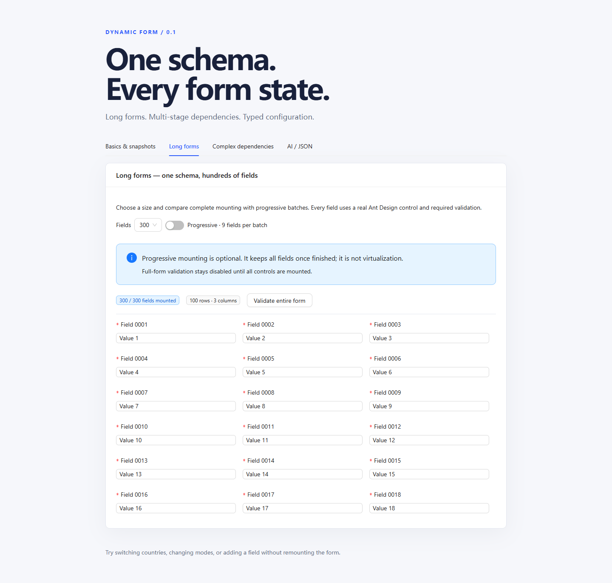

# Dynamic Form — schema-driven forms for low-code and AI-assisted development

[中文](README.md) · [Quick start](docs/GETTING_STARTED.md) · [Configuration](docs/CONFIGURATION.md) · [Recipes](docs/RECIPES.md) · [API](docs/API.md)

A TypeScript form library with an independent configuration engine and a React / Ant Design adapter. Configure field order, layout, validation, data sources, dependencies, and edit / preview / snapshot rendering.

## Long forms and complex dependencies

- Try 100, 300 or 1,000 fields with complete or progressive mounting and full-form validation.
- Combine asynchronous dependent options, multi-stage calculations, dynamic attributes and conditional validation.
- Read the [illustrated examples](docs/EXAMPLES.md), [browser benchmark report](docs/PERFORMANCE.md) and raw samples. Progressive mounting trades first-batch latency against total completion time; it is not virtualization.



## Low-code and AI integration

Use Dynamic Form as a rendering layer for stored form definitions, validate AI-generated JSON before rendering, or give a coding assistant the typed API and examples. The repository includes a [configuration JSON Schema](schemas/form-definition.schema.json), a working [JSON form example](examples/ai/JsonFormExample.tsx), and [llms.txt](llms.txt). See the [AI integration guide](docs/AI_INTEGRATION.md) for the full workflow and supported subset.

This is a form engine, not a complete drag-and-drop builder or an LLM backend. It does not render arbitrary JSON Schema documents.

## Try the playground

Use Node.js 22.12+ (or Node.js 20.19+).

```bash
git clone https://github.com/eugeneaiao-ui/dynamic-form.git
cd dynamic-form
npm ci
npm run dev
```

Until the illustrated examples and performance PR is merged, check out `codex/examples-performance` for these additions.

## Install in an application

The package has **not been published to npm**. Build and pack this repository first:

```bash
npm run build
npm pack
# Run in your application, using the actual tarball path:
npm install /absolute/path/eugeneaiao-ui-dynamic-form-0.1.0.tgz
```

The UI adapter requires React, ReactDOM, and Ant Design in the host application. Verified combinations are React 16.14 + AntD 4.24, React 18.3 + AntD 5.27, and React 19.1 + AntD 5.27. AntD 4 requires a moment date adapter; AntD 5 uses dayjs by default.

## Minimal form

```tsx
import React from 'react';
import { DynamicForm, FormComponent, FormFieldType, useDynamicConfig } from '@eugeneaiao-ui/dynamic-form';
import '@eugeneaiao-ui/dynamic-form/style.css';

const template = [{ name: 'name', type: FormFieldType.Input }];
const fields = { name: { label: 'Name', rules: [{ required: true }] } };

function Fields() {
  const { formConfig } = useDynamicConfig({ template, fields });
  return <FormComponent formConfig={formConfig} />;
}

export function Example() {
  return (
    <DynamicForm onFinish={(values) => console.log(values)}>
      <Fields />
      <button type="submit">Submit</button>
    </DynamicForm>
  );
}
```

Keep hooks in a child of DynamicForm / DynamicFormProvider. Import the library stylesheet explicitly and configure AntD styles in the host application.

## Configuration model

| Layer         | Responsibility                                                |
| ------------- | ------------------------------------------------------------- |
| template      | Field names, order, type, and 24-column layout                |
| fields        | Labels, rules, componentProps, dataSource, dependenciesConfig |
| middlewares   | Synchronous configuration transformations                     |
| DynamicForm   | Form state, validation, submission, mode, adapters            |
| FormComponent | Rendering the generated formConfig                            |

Field definitions override template properties with a shallow merge; middleware runs afterwards. Use immutable configuration updates. API sources must declare dependsOn for reactive parameters. Custom controls and application services are injected through registry / dataSources / dataContext.

The `/core` entry has no React or AntD imports. Root and `/antd` exports provide the UI adapter. All JavaScript entries support ESM / CommonJS with matching declarations.

The detailed guides are currently in Chinese. The [quick-start source](examples/quick-start/ProfileForm.tsx) and [configuration recipes](examples/configuration/recipes.tsx) are typechecked examples with English field labels.

## Development

```bash
npm run check
npm run check:docs
npm run test:package
```

See [CONTRIBUTING](CONTRIBUTING.md) for the development and manual release process, and [CHANGELOG](CHANGELOG.md) for changes. CI does not publish npm packages.

## License

[MIT](LICENSE).
