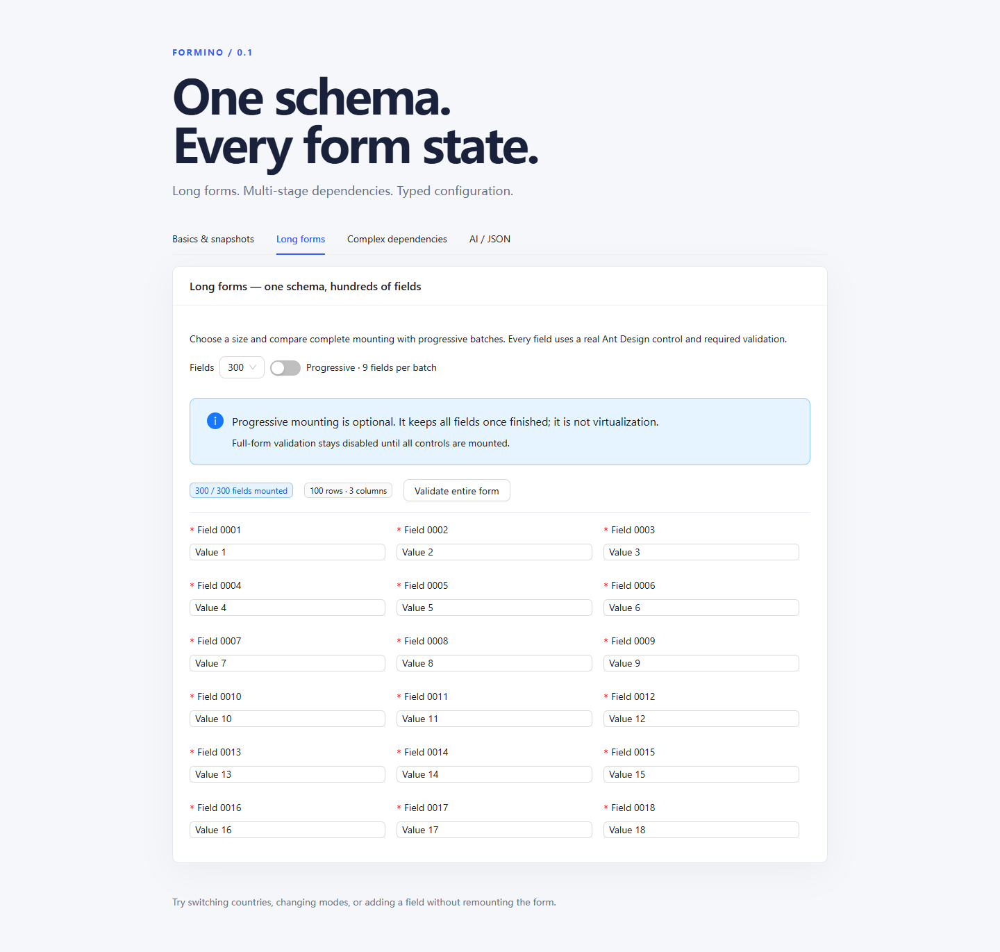
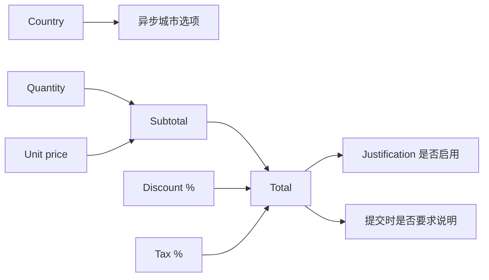
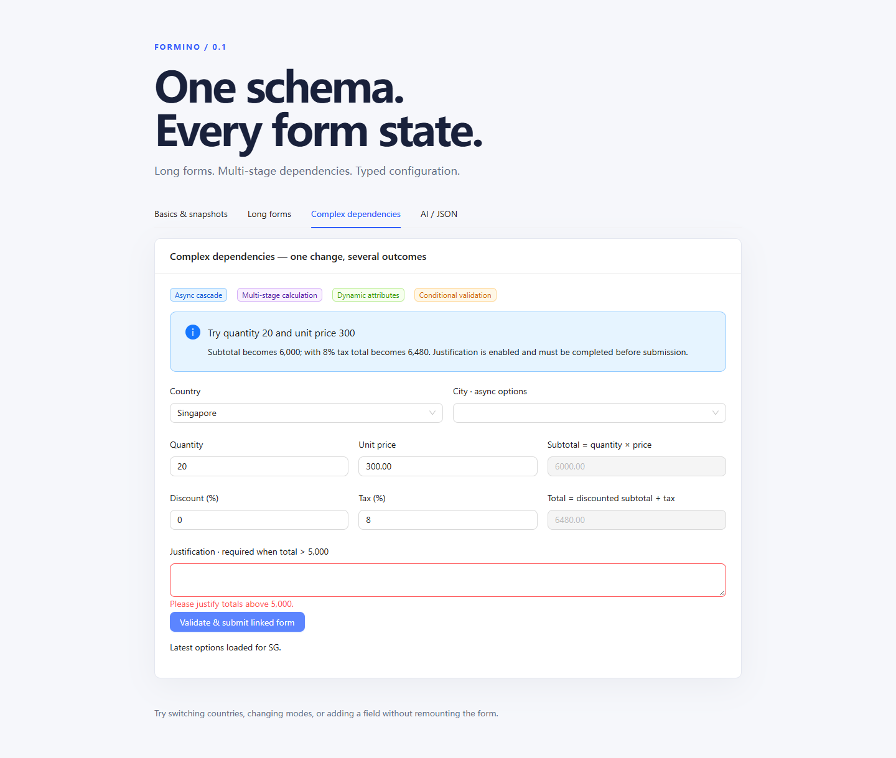
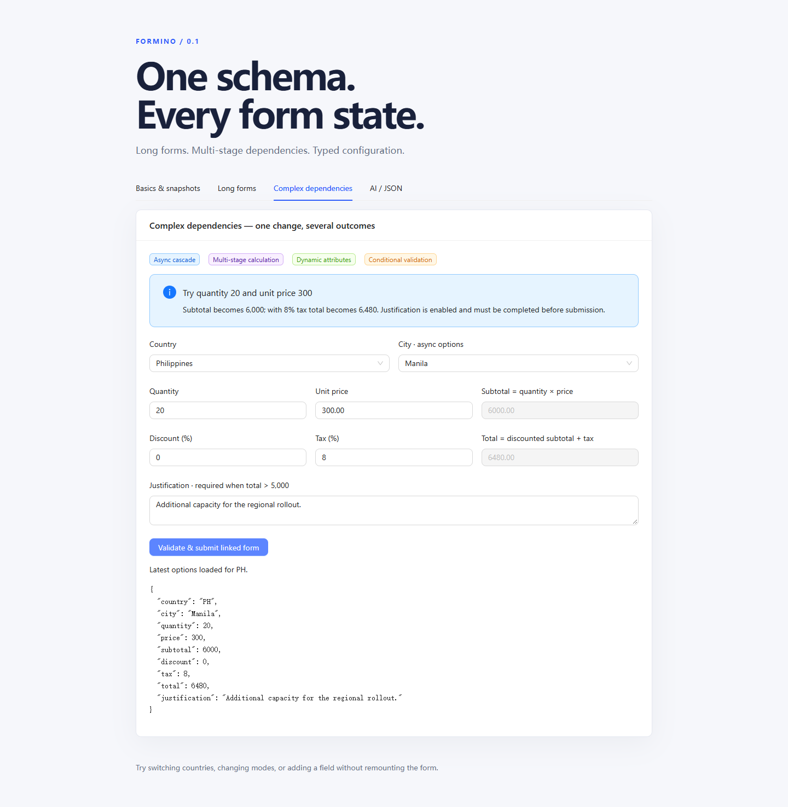
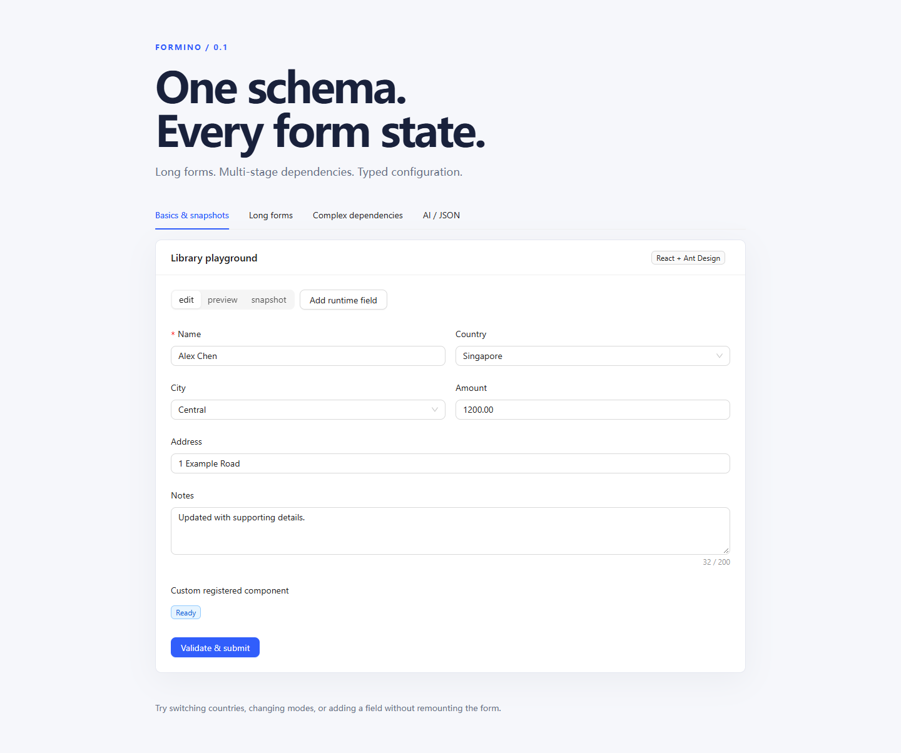
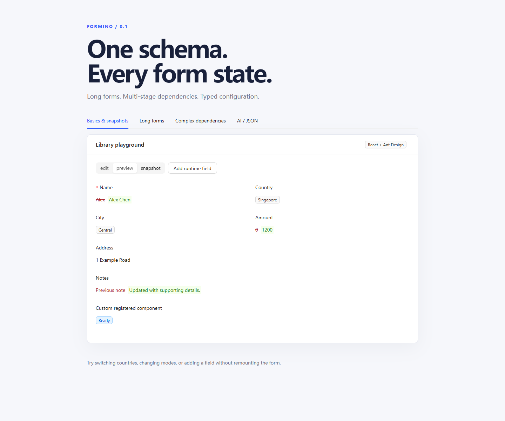
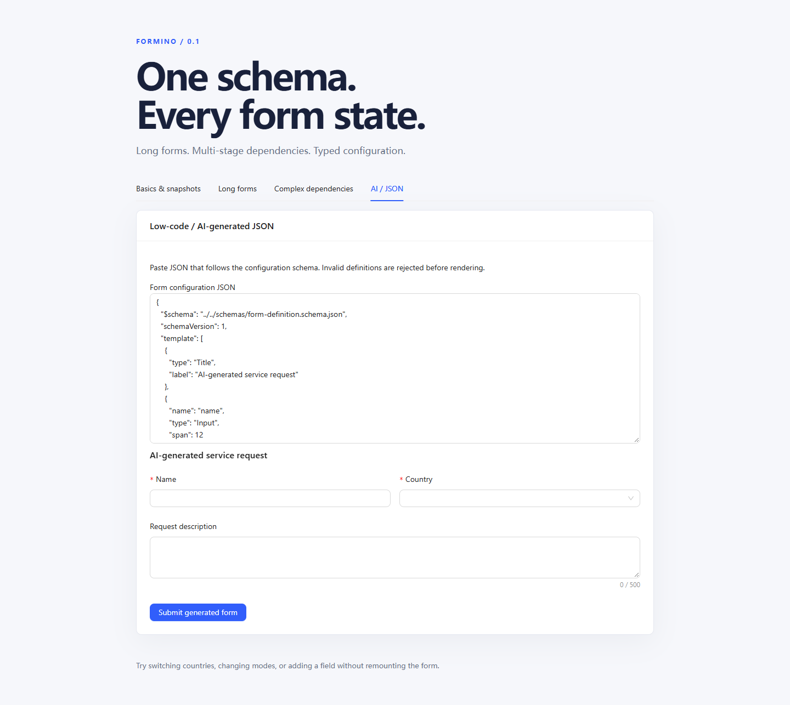

# 图文示例：长表单、复杂联动与 AI 配置

[返回首页](../README.md) · [配置手册](CONFIGURATION.md) · [性能数据](PERFORMANCE.md)

所有图片来自本仓库生产构建的真实 Chrome 页面。数据为演示数据，图片由 npm run examples:screenshots 自动生成。

## 运行和选择示例

```bash
npm ci
npm run dev
```

打开终端地址，通过顶部标签选择。也可以在该地址后加 ?example=basic、?example=long、?example=linked 或 ?example=ai。

| 示例                 | 核心能力                                                   | 源码                                                                                               |
| -------------------- | ---------------------------------------------------------- | -------------------------------------------------------------------------------------------------- |
| Basics & snapshots   | 编辑、预览、字段差异与配置更新                             | [Playground.tsx](https://github.com/eugeneaiao-ui/formino/blob/main/examples/basic/Playground.tsx) |
| Long forms           | 100 / 300 / 1000 字段、三列布局、完整 / 分批挂载、整表校验 | [LongFormExample.tsx](../examples/advanced/LongFormExample.tsx)                                    |
| Complex dependencies | 异步级联、多级计算、动态禁用、条件校验                     | [ComplexDependenciesExample.tsx](../examples/advanced/ComplexDependenciesExample.tsx)              |
| AI / JSON            | JSON 校验后渲染、修改配置、校验及提交                      | [JsonFormExample.tsx](../examples/ai/JsonFormExample.tsx)                                          |

## 1. 长表单：300 字段仍是一张表单



图中 300 / 300 表示控件已全部挂载，而不是仅在配置中声明了 300 项。右侧滚动区域保留所有字段，按钮会对整张表单执行校验。

操作步骤：

1. 选择 100、300 或 1000 字段，生成相应模板。
2. 默认使用完整挂载。开启 Progressive 后，每次按 3 行、每行 3 项挂载下一批。
3. 等计数完整后，点击 Validate entire form；清空一个字段再校验，可以看到对应 required 错误。
4. 查看[实测数据](PERFORMANCE.md)，分别比较首批 DOM 与全部就绪时间。

核心配置：

```tsx
const { formConfig } = useDynamicConfig({ template, fields });

<FormComponent formConfig={formConfig} progressive={true} rowsPerBatch={3} />;
```

template 中每项 span: 8，因此每批为 3 × 3 = 9 项。实际字段数量没有写在引擎里；演示数据生成器在 [fixtures.ts](../examples/performance/fixtures.ts)。输入类型、规则和控件复杂度都会影响性能。

**分批挂载不是虚拟滚动。** 全部完成后仍有完整 DOM 和表单状态，整表校验应等所有控件注册后执行。本示例会在挂载未齐时禁用校验按钮。

## 2. 复杂联动：一次输入触发多种变化



### 多级计算与条件校验



操作：

1. 把 Quantity 改为 20，Unit price 改为 300。
2. Subtotal 自动写成 6,000；默认税率 8%、折扣 0%，Total 自动写成 6,480。
3. Total 超过 5,000，Justification 自动启用。
4. 不填说明直接提交，会出现红色校验错误。填入说明后才通过。

多级计算使用实际字段值继续传播，不需要页面手动依次调用各个计算函数：

```tsx
const totalField = {
  dependenciesConfig: {
    type: DependentTypeEnum.COMPUTE,
    dependsOn: ['subtotal', 'discount', 'tax'],
    calculate: ([subtotal, discount, tax]) =>
      Math.round(Number(subtotal ?? 0) * (1 - Number(discount ?? 0) / 100) * (1 + Number(tax ?? 0) / 100) * 100) / 100,
  },
};
```

Justification 使用 ATTRIBUTE 根据 total 修改 disabled，rules 中的 validator 在校验时读取当前 total。说明要求不依赖旧快照，也不把 0 当成缺失值。

### 异步级联与最终提交



切换 Country 到 Philippines，City 会清空旧选择并加载 Manila / Cebu。此处使用本地模拟的 200 ms 异步请求，不依赖外部服务；状态行显示最新完成的国家选项。请求支持 AbortSignal，过期结果不会覆盖新结果。

完整路径是：修改国家 → 异步选项更新 → 选择城市 → 计算金额 → 填写条件说明 → 提交完整值。截图脚本会实际执行这一路径，并等待成功提交。

联动配置建议：

- dependsOn 必须显式列出全部依赖；数组顺序就是 calculate 参数顺序。
- 使用 COMPUTE / FETCH / STORE 返回新值，使用 ATTRIBUTE 返回控件属性补丁。
- 需要异步时接收 signal，避免旧计算结果覆盖新值。
- 保持配置引用稳定，避免循环依赖。初次挂载也会计算，编辑页不要无条件覆盖接口回填值。
- 校验规则、控件属性和数据值分别配置，业务权限仍由宿主处理。

## 3. 编辑、预览与快照



编辑模式使用真实 AntD 控件及 required 校验；Add runtime field 按钮说明模板可以在不重新载入页面的情况下更新。


预览使用 FormMode.preview；Select 显示 label，而不是只显示存储值。



快照使用 FormMode.snapshot 与 createSnapshotMiddleware(before, after)。标记表示修改前后差异；自定义组件可自行注册 snapshot 实现。

## 4. AI / JSON：从配置到可提交表单



上方是 JSON 编辑区，下方是通过既有引擎渲染的表单；调整合法配置会重新渲染，非法配置显示错误。页面没有调用 LLM，模型调用由使用方接入。

完整说明见 [AI / 低代码接入](AI_INTEGRATION.md)。该 JSON 协议是受约束的可序列化子集；长表单与复杂函数联动使用完整 TypeScript API，不要求把函数塞进 JSON。

## 生成截图与复测

```bash
npm run examples:screenshots
npm run benchmark
```

两个命令都构建生产页面，使用独立 headless Chrome。第一条只验证并重截示例，第二条先测量，再截图；避免把截图开销混入计时。没有 Chrome 的环境可按[性能报告](PERFORMANCE.md#如何复现)使用 Playwright Chromium。

这些截图验证了控件渲染、多级计算、条件校验、异步城市选择和最终提交；它们不替代你的业务接口、权限和实际大表单的验证。
